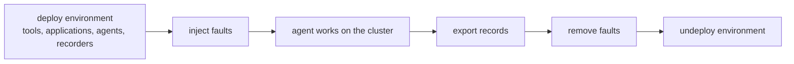

# ITBench Ansible Project

This directory is the Ansible project that the `itbench` CLI drives through [ansible-runner](https://ansible.readthedocs.io/projects/runner/). It deploys the benchmark environment onto a Kubernetes or OpenShift cluster, injects faults, records telemetry, and schedules benchmark trials.

>[!IMPORTANT]
>Most users never run these playbooks directly. Unless otherwise stated in the [documentation](../documentation), please use the CLI over directly invoking the playbooks.

Variables shared by all roles (images, Helm releases, namespaces, FQDNs) live in [`inventory/group_vars/all/`](../inventory/group_vars/all/).

## Playbooks

| Playbook | Runs against | Roles (in order) | CLI commands |
|---|---|---|---|
| [`manage_environment.yaml`](manage_environment.yaml) | the environment cluster | `cluster`, then `tools`, `applications`, `agents`, `recorders` | `deploy environment`, `undeploy environment`, `export records` |
| [`manage_faults.yaml`](manage_faults.yaml) | the environment cluster | `waiters` (pre), `faults`, `waiters` (post) | `inject faults`, `remove faults` |
| [`manage_orchestrator.yaml`](manage_orchestrator.yaml) | the orchestrator cluster | `cluster`, then `argo` | `deploy orchestrator`, `configure orchestrator`, `schedule benchmark`, `undeploy orchestrator` |

Each role in `manage_environment.yaml` is switched on by an extra variable, so one playbook serves every command:

| Role | Enabled by |
|---|---|
| `tools` | `environment_tool_management_enabled` |
| `applications` | `environment_application_management_enabled` |
| `agents` | `environment_agent_management_enabled` |
| `recorders` | `environment_recorder_management_enabled` |

Helm is resolved with `mise which helm`, so the playbooks expect to run inside the repository's `mise` environment.

## Roles

| Role | What it does | Tags |
|---|---|---|
| `cluster` | Detects the platform (`kubernetes` or `openshift`) and provider, and checks the minimum server version. Sets `cluster_platform` and `cluster_provider`. | `always` |
| `tools` | Infrastructure: Gateway controller, cert-manager, Prometheus, ClickHouse, OpenTelemetry, OpenCost, Kyverno, Istio, and the Jaeger and Prometheus MCP servers. Groups are gated by `tools_governance_enabled`, `tools_observability_enabled` and `tools_service_mesh_enabled`. | `install`, `uninstall` |
| `applications` | The demo applications (Bank of Anthos, Microservices Demo, OpenTelemetry Demo), each with its own collector and alert rules. | `install`, `uninstall` |
| `agents` | What an AI agent is given: an MCP Gateway with TLS, read-only (diagnosis) and optional write (remediation) RBAC, admission policies, network policies, and the `itbench-agent-bundle` Secret. | `install`, `uninstall` |
| `recorders` | Collects the Kubernetes topology and, at the end of a run, exports ClickHouse and Prometheus records to S3 or a local directory. | `install`, `export`, `uninstall` |
| `faults` | Injects and removes faults. See [Faults and waiters](#faults-and-waiters). | `inject_faults`, `remove_faults` |
| `waiters` | Waits before or after injection (for example for a rollout, or a pause). | `inject_faults` |
| `argo` | Argo Workflows, its Gateway, the environment kubeconfig Secrets, the `itbench-scenario-execution` WorkflowTemplate, and scheduling of trials. | `install`, `configure`, `schedule`, `uninstall` |

## Lifecycle



Undeploy runs in the reverse order of deploy: applications, agents, recorders, then tools. Agents are deployed after applications because they snapshot the application namespaces (RoleBindings, network policies and the image allowlist).

The Argo `itbench-scenario-execution` WorkflowTemplate runs this same sequence through the CLI against one registered environment cluster, so a benchmark trial is not a separate code path.

## Faults and waiters

`manage_faults.yaml` takes three lists, built from a scenario by the CLI: `pre_injection_tasks`, `injection_tasks` and `post_injection_tasks`.

Dispatch is by file name. A task with `id: nonexistent-kubernetes-workload-container-image` runs
`roles/faults/tasks/inject_nonexistent_kubernetes_workload_container_image.yaml` (dashes become underscores). A waiter runs `roles/waiters/tasks/wait_<id>.yaml` the same way.

To add a fault, follow [Developing Faults](../documentation/developer/faults.md). Faults that only touch the application namespace need no removal task, because undeploy deletes the namespace. Faults that change cluster-wide objects must be reversed in [`remove.yaml`](roles/faults/tasks/remove.yaml).

## Conventions

- Every task file is named `<verb>[_<thing>].yaml`; each role's `main.yaml` only imports `install`, `uninstall` and similar entry points under tags.
- Every object the project creates carries `itbench.io/ansible-role` (the role that owns it) and `itbench.io/layer`. Uninstall tasks delete by these labels, so a new object must have them or it will survive undeploy.
- Namespace labels select behavior:

| Label | Meaning |
|---|---|
| `itbench.io/inject=true` | Faults may be injected and agents may write here. |
| `itbench.io/record=true` | The recorders collect from here. |
| `itbench.io/monitor=true` | Prometheus scrapes here. |
| `itbench.io/gateway-access=shared` | Routes from this namespace may attach to the Gateways. |
| `itbench.io/protected=true` (on a NetworkPolicy) | Agents may not change or delete it. |

- Platform differences are handled inside tasks with `when: <role>_cluster.platform == ...`, where `<role>_cluster` is passed in by the playbook (`tools_cluster`, `applications_cluster`, `agents_cluster`, `recorders_cluster`, `argo_cluster`).
- Secrets are created with `no_log: true`.

## Running a playbook directly

Use the CLI where you can. To run a playbook by hand, pass the same variables and tags the CLI does, for example:

```shell
ansible-playbook -i inventory project/manage_environment.yaml \
  --tags install \
  -e environment_tool_management_enabled=true \
  -e tools_observability_enabled=true
```

`K8S_AUTH_KUBECONFIG` must point at the target cluster.
